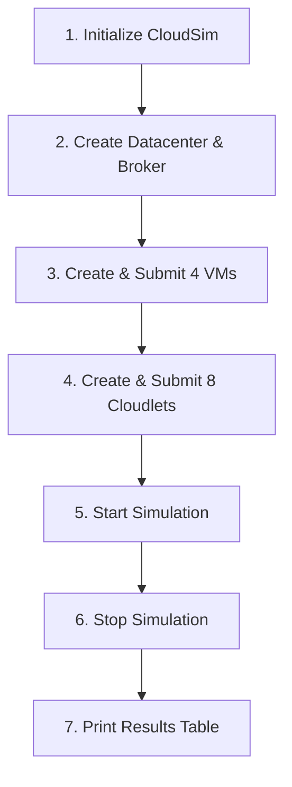

# Experiment 11 — CloudSim Setup & Resource Allocation

This folder contains the complete procedures for **Experiment 11(A)** (Installation & Configuration) and **Experiment 11(B)** (Simple Resource Allocation Algorithm), along with the complete Java code.

---

## 📋 Experiment 11(A) — Installation of CloudSim

### Aim:
To install and configure CloudSim in Eclipse IDE.

### Requirements:
- **Java Development Kit (JDK)** (JDK 8 or JDK 11 recommended)
- **Eclipse IDE for Java Developers**
- **CloudSim 5.0** (or 3.0.3)
- **Apache Commons Math** library

### 🔗 Reference Download Links:
- **CloudSim 5.0 Release:** [https://github.com/Cloudslab/cloudsim/releases/tag/5.0](https://github.com/Cloudslab/cloudsim/releases/tag/5.0)
- **Apache Commons Math:** [https://commons.apache.org/proper/commons-math/download_math.cgi](https://commons.apache.org/proper/commons-math/download_math.cgi)

---

### Procedure:

#### Step 1: Download CloudSim
1. Open the browser and navigate to the GitHub release:
   `https://github.com/Cloudslab/cloudsim/releases/tag/5.0`
2. Download the `cloudsim-5.0.tar.gz` or `.zip` file and extract it to a known directory on your system.

#### Step 2: Download Commons Math
1. Navigate to the Apache Commons Math download page.
2. Download the binary archive (e.g. `commons-math3-3.6.1-bin.zip`).
3. Extract the downloaded files to access the `.jar` files (e.g. `commons-math3-3.6.1.jar`).

#### Step 3: Create a Java Project in Eclipse
1. Launch **Eclipse IDE**.
2. Click **File** → **New** → **Java Project**.
3. Enter the project name (e.g., `CloudSimSetup`).
4. Select the Java execution environment (e.g., JavaSE-1.8 or JavaSE-11) and click **Finish**.

#### Step 4: Add Library Files
1. Right-click your project in the Package Explorer → **Properties**.
2. Navigate to **Java Build Path** → click the **Libraries** tab.
3. Click **Add External JARs...**.
4. Select:
   - The CloudSim jar files from your extracted CloudSim `jars/` folder.
   - The `commons-math3-3.6.1.jar` from the extracted Commons Math folder.
5. Click **Apply and Close**.

#### Step 5: Verify Installation
1. Expand the CloudSim project in the Package Explorer.
2. Check whether the `examples` package (`org.cloudbus.cloudsim.examples`) and its sample Java files (like `CloudSimExample1.java`) are visible and free of build errors.
3. Run `CloudSimExample1.java` as a **Java Application** to verify clean output in the console.

### Result:
Thus, CloudSim was installed and configured successfully in Eclipse IDE.

---

## 💻 Experiment 11(B) — Implementation of a Simple Resource Allocation Algorithm on CloudSim

### Aim:
To implement a simple resource allocation algorithm in a cloud scenario simulation using CloudSim.

### Requirements:
- JDK
- Eclipse IDE
- CloudSim 3.0.3
- Commons Math library

### 🔗 Reference Link:
- **CloudSim 3.0.3 Release:** [https://github.com/Cloudslab/cloudsim/releases/tag/cloudsim-3.0.3](https://github.com/Cloudslab/cloudsim/releases/tag/cloudsim-3.0.3)

---

### Procedure:

#### Step 1: Download CloudSim 3.0.3
1. Download CloudSim 3.0.3 from:
   `https://github.com/Cloudslab/cloudsim/releases/tag/cloudsim-3.0.3`
2. Extract the downloaded archive.

#### Step 2: Create a Project in Eclipse
1. Open Eclipse → **File** → **New** → **Java Project**.
2. Name the project `cloudsim`.
3. Under *Project location*, uncheck *Use default location* and browse to the extracted **CloudSim 3.0.3** directory. Click **Finish**.

#### Step 3: Add JAR Files
1. Right-click the project → **Build Path** → **Configure Build Path...**.
2. Under **Libraries**, click **Add External JARs...**.
3. Add the required **Commons Math** JAR (`commons-math3-3.6.1.jar`) and any missing dependency JARs.

#### Step 4: Check the Project
1. Expand the project tree in the Package Explorer.
2. Verify that `org.cloudbus.cloudsim.examples` and the **Referenced Libraries** section show no red error flags.
3. Run `CloudSimExample1.java` to test the environment.

#### Step 5: Create the Program File
1. In `src/` (or inside package `org.cloudbus.cloudsim.examples`), right-click → **New** → **Class** (or **File**).
2. Name the class `BasicResourceAllocation.java`.

#### Step 6: Implement Resource Allocation
1. Write or paste the Java code from [`BasicResourceAllocation.java`](./BasicResourceAllocation.java).
2. The simulation scenario initializes:
   - **1 Datacenter** (`Datacenter_0`) with 4 Hosts (each with 2048 MB RAM, 1000000 MB storage, 10000 BW, and 1 CPU core at 1000 MIPS).
   - **1 Datacenter Broker** (`Broker`).
   - **4 Virtual Machines (VMs)** (1000 MIPS, 1 CPU, 1024 MB RAM, 10000 BW, Time-Shared Cloudlet Scheduler).
   - **8 Cloudlets** (40000 MI length, 1 CPU, 300 MB file size/output size, Full Utilization Model).
   - Allocation Policy: Simple VM Allocation Policy (`VmAllocationPolicySimple`).

#### Step 7: Compile and Run
1. Right-click `BasicResourceAllocation.java` → **Run As** → **Java Application**.
2. Observe the execution in the Eclipse console displaying:
   - Cloudlet ID
   - STATUS (`SUCCESS`)
   - Data center ID
   - VM ID
   - Execution Time
   - Start Time
   - Finish Time

---

### 🧠 Important Program Flow to Remember:

1. **Initialize CloudSim:** `CloudSim.init(numUsers, calendar, traceFlag)`
2. **Create Datacenter and Broker:** `createDatacenter("Datacenter_0")` and `createBroker()`
3. **Create and Submit VMs:** Define VM list (`vmCount = 4`) and call `broker.submitVmList(vmList)`
4. **Create and Submit Cloudlets:** Define cloudlet list (`cloudletCount = 8`) and call `broker.submitCloudletList(cloudletList)`
5. **Start Simulation:** `CloudSim.startSimulation()`
6. **Stop Simulation:** `CloudSim.stopSimulation()`
7. **Print Results:** Retrieve `broker.getCloudletReceivedList()` and print formatted table.

---

### 📊 Simulation Parameters Summary:

| Parameter | Value | Details |
|---|---|---|
| **Datacenters** | 1 (`Datacenter_0`) | x86 architecture, Linux OS, Xen VMM |
| **Hosts** | 4 | 1000 MIPS (1 PE), 2048 MB RAM, 1 TB Storage, 10000 BW |
| **VMs** | 4 | 1000 MIPS, 1 PE, 1024 MB RAM, 10000 BW, Xen |
| **Cloudlets** | 8 | Length: 40,000 MI, 1 PE, File Size: 300, Output Size: 300 |
| **VM Scheduler** | Time-Shared | `VmSchedulerTimeShared` |
| **Cloudlet Scheduler** | Time-Shared | `CloudletSchedulerTimeShared` |
| **Allocation Policy** | Simple | `VmAllocationPolicySimple` |

---

### Result:
Thus, the implementation of a simple resource allocation algorithm on CloudSim was completed successfully.
